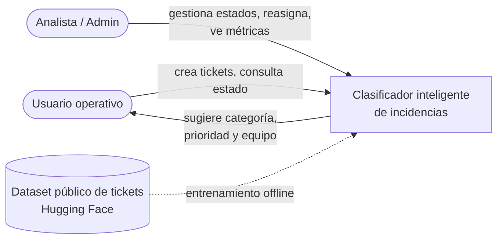
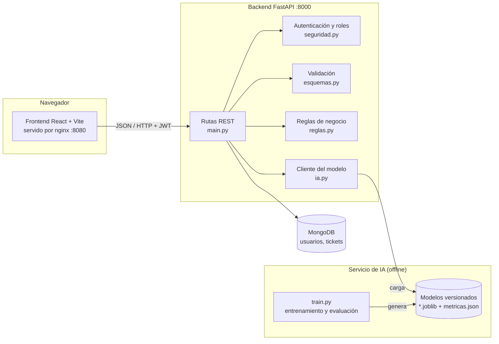
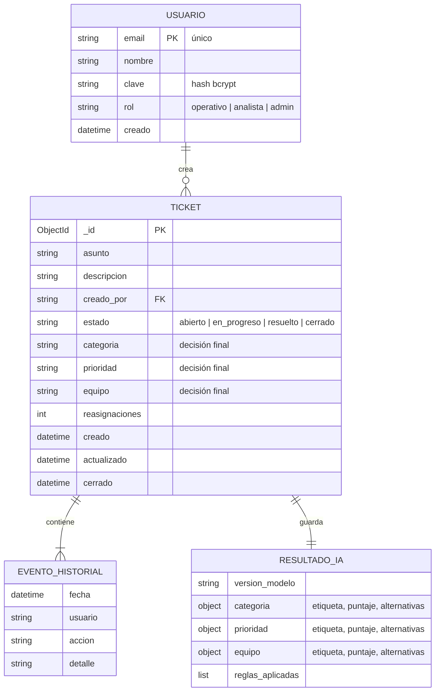
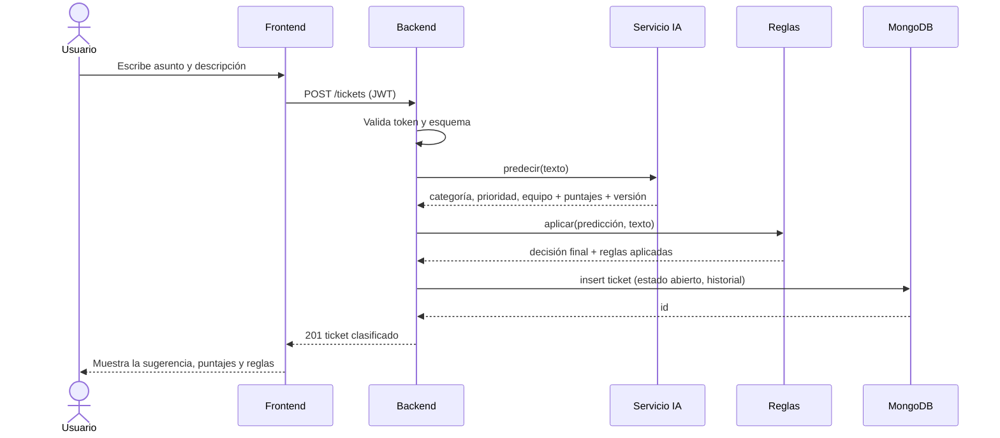
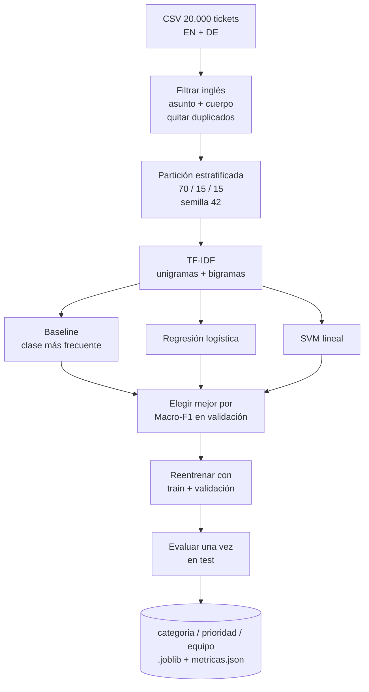
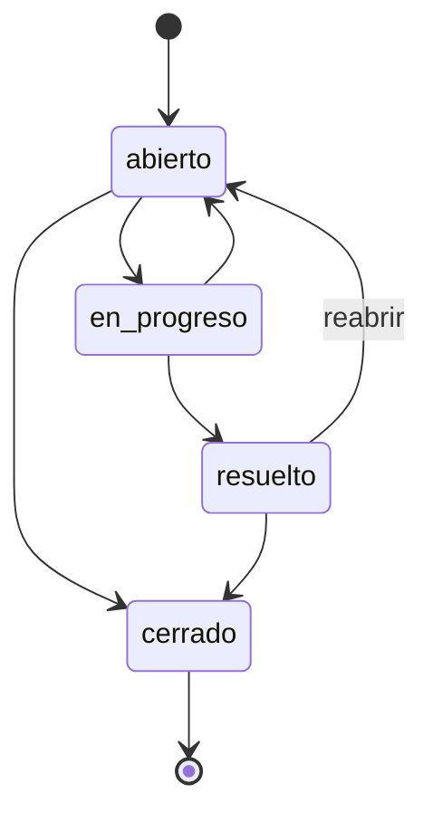

# 2. Arquitectura y diseño

Los diagramas están en Mermaid: GitHub los dibuja automáticamente al abrir este archivo.

## 2.1 Diagrama de contexto



## 2.2 Diagrama de contenedores / componentes



**Por qué así:** el modelo se carga desde archivos versionados detrás de una sola interfaz (`ia.predecir(texto)`). Para cambiar de modelo basta con reentrenar y reemplazar los archivos: la API, las reglas y la interfaz no cambian. La versión del modelo queda guardada en cada ticket.

## 2.3 Modelo de datos (MongoDB)



`RESULTADO_IA` y `EVENTO_HISTORIAL` son subdocumentos dentro del ticket (campos `ia` e `historial`). Se guarda **por separado** lo que dijo el modelo y la decisión final, para poder medir después cuántas veces se corrigió al modelo.

## 2.4 Secuencia del caso principal: crear un ticket



## 2.5 Pipeline de IA



## 2.6 Ciclo de vida del ticket



## 2.7 API REST

Documentación interactiva completa: `http://localhost:8000/docs`.

| Método | Ruta | Rol | Descripción |
|---|---|---|---|
| GET | `/salud` | público | Estado y versión del modelo |
| POST | `/auth/registro` | público | Crea usuario operativo |
| POST | `/auth/login` | público | Devuelve token JWT |
| GET | `/auth/yo` | cualquiera | Datos del usuario actual |
| GET | `/usuarios` | admin | Lista usuarios |
| PATCH | `/usuarios/{email}/rol` | admin | Cambia rol |
| POST | `/clasificar` | cualquiera | Solo predicción, no guarda |
| POST | `/tickets` | cualquiera | Crea y clasifica |
| GET | `/tickets?estado=&equipo=` | cualquiera | Lista (operativo: solo los suyos) |
| GET | `/tickets/{id}` | dueño o gestor | Detalle con historial |
| PATCH | `/tickets/{id}/estado` | analista, admin | Cambia estado (solo transiciones válidas) |
| PATCH | `/tickets/{id}/asignacion` | analista, admin | Reasigna equipo |
| GET | `/metricas` | analista, admin | Métricas de software y del modelo |

**Contrato del servicio de IA** (lo que devuelve `ia.predecir`):

```json
{
  "version_modelo": "v202610082247",
  "categoria": {"etiqueta": "Problem", "puntaje": 0.3686,
                "alternativas": [{"etiqueta": "Change", "puntaje": 0.243}, {"etiqueta": "Incident", "puntaje": 0.197}]},
  "prioridad": {"etiqueta": "low", "puntaje": 0.4516, "alternativas": ["…"]},
  "equipo":    {"etiqueta": "IT Support", "puntaje": 0.129, "alternativas": ["…"]}
}
```

Ejemplo real para *"VPN not connecting…"*. Aquí el puntaje del equipo (0,129) queda por debajo del umbral, así que la regla R2 lo envía a revisión manual: el modelo duda entre IT Support (0,129) y Customer Service (0,126), y el sistema lo deja ver en lugar de esconderlo.


## 2.8 Wireframes (pantallas implementadas)

1. **Ingreso / registro:** correo, clave y botón para cambiar a registro.
2. **Tickets:** tabla con asunto, categoría, prioridad, equipo, estado y fecha; filtro por estado.
3. **Nuevo ticket:** asunto, descripción y, al guardar, la tarjeta *"Lo que sugirió la IA"* con barras de puntaje, alternativas y reglas aplicadas.
4. **Detalle:** datos del ticket, resultado de la IA, panel *Gestionar* (estados y reasignación) e historial.
5. **Dashboard:** indicadores (tickets, lead time, tasa de reasignación), tabla de calidad del modelo y conteos por estado, prioridad, categoría y equipo.

## 2.9 Decisiones técnicas

| Decisión | Alternativa descartada | Motivo |
|---|---|---|
| FastAPI | Flask, Django | Validación con Pydantic y OpenAPI incluidos; sugerido por el enunciado |
| MongoDB | PostgreSQL | El ticket es un documento con subdocumentos (IA, historial); sugerido por el enunciado |
| TF-IDF + SVM lineal | Transformer (BERT) | Supera claramente al baseline, entrena en segundos sin GPU y es fácil de explicar; un transformer queda como trabajo futuro |
| Modelo cargado dentro del proceso de la API | Microservicio aparte | Para un solo modelo pequeño evita latencia de red; la interfaz `ia.py` permite separarlo después |
| React + Vite | Plantillas del servidor | Sugerido por el enunciado; interfaz independiente del backend |
